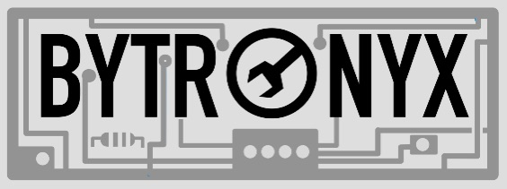
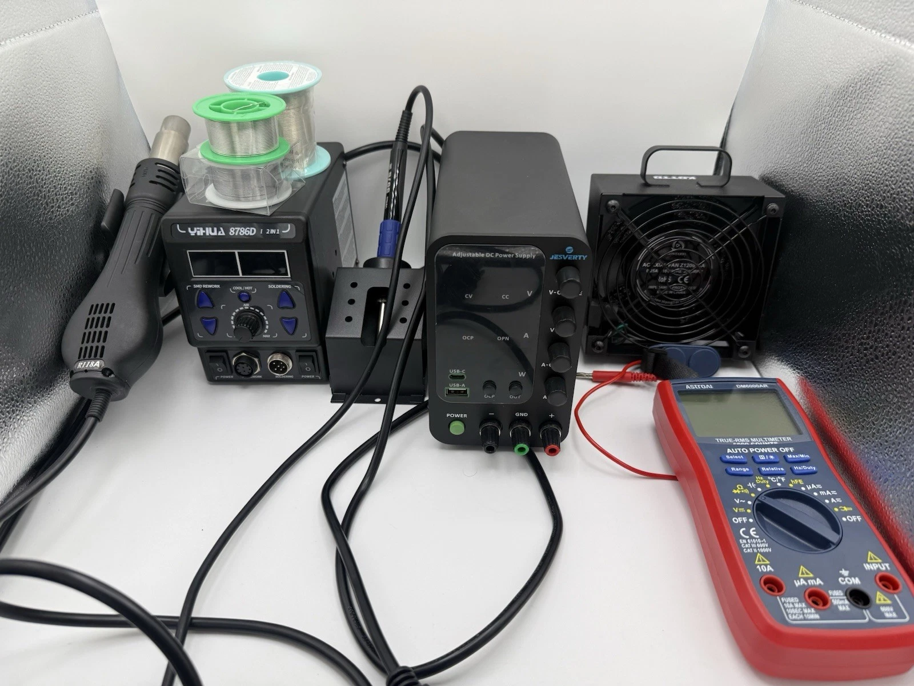
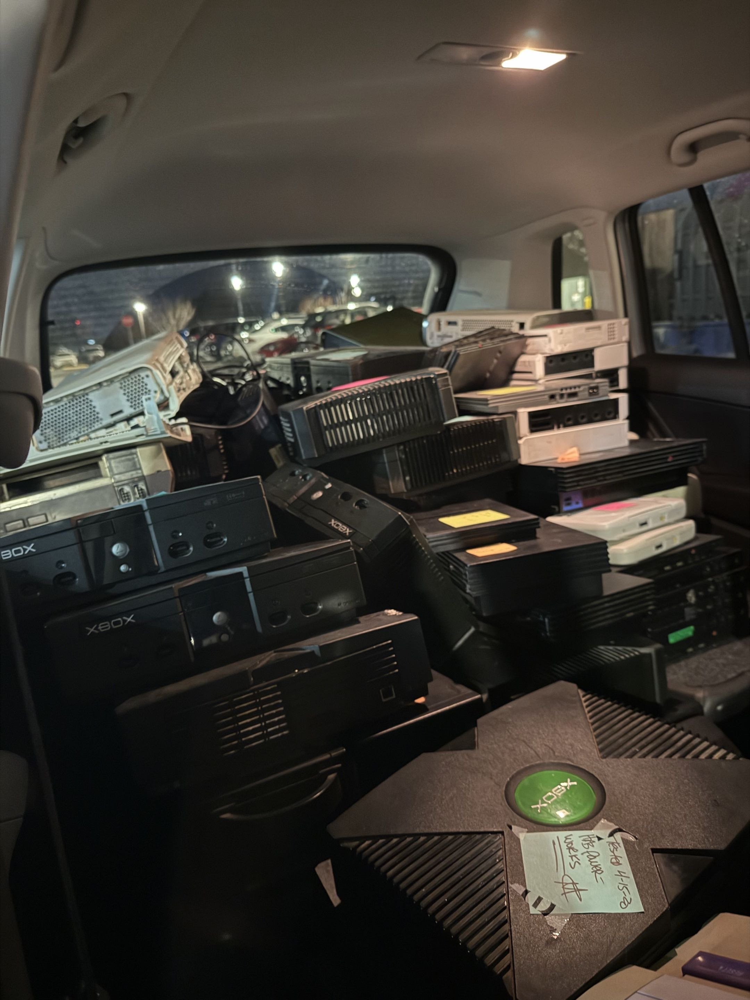
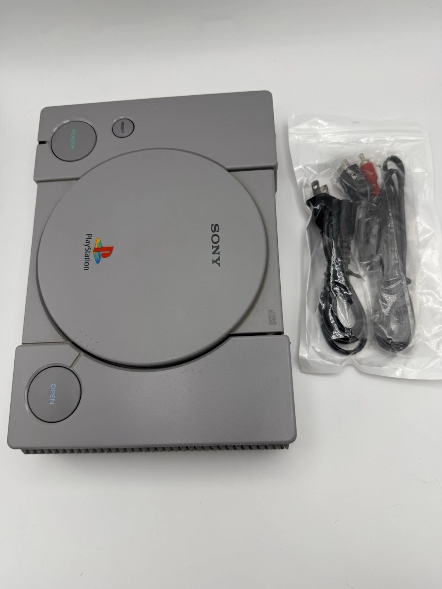
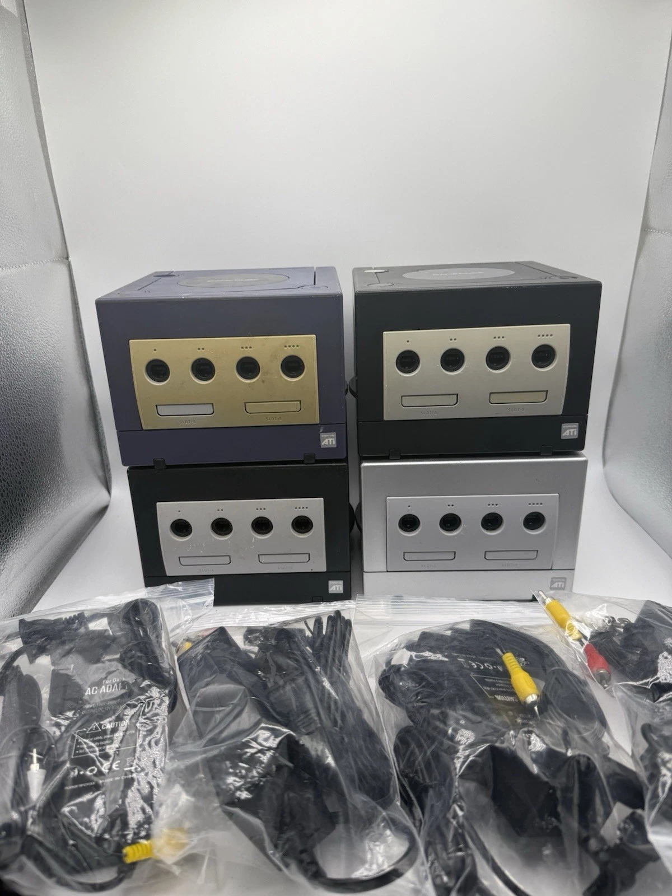
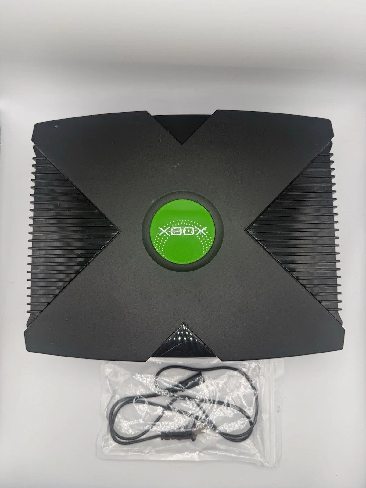

# Bytronyx

[Repair log](repairs/README.md) · [Photos](docs/photo-gallery.md) · [Behind Bytronyx](docs/behind-bytronyx.md)

Bytronyx was my electronics repair and resale business. I bought broken consoles
and controllers, worked out what was wrong, repaired them, and sold them.

This repository holds my repair notes, inventory, and photos.

## Repair examples

- [Xbox 360 power fault](repairs/records/EX-136.md): traced a shorted MOSFET and checked the supply rail after replacement.
- [PS3 disc loading and USB port](repairs/records/EX-092.md): replaced the laser pickup and a damaged USB socket.
- [PlayStation video output](repairs/records/EX-042.md): repaired solder joints at the AV jack and checked picture and audio.

## Repair log

The [full log](repairs/README.md) has 248 entries: 136 consoles, 100 controllers,
and 12 accessories. Of those, 221 were repaired, 12 tested working, five serviced,
five replaced with another console, and five were left pending.
The [record notes](records/README.md) explain how the overlapping inventories
were combined.

Each entry records the fault, checks, work done, testing, and costs. The
[spreadsheet](records/repair-register.csv) collects those records in one place.
I put the log together from my notes, spreadsheets, recollections, and photos;
[these notes](docs/documentation-approach.md) explain what I could document.

## Tools

I used a soldering and hot-air station, an adjustable DC supply, a multimeter,
and hand tools for the repair work.

## Buying and sorting stock

This was a batch of broken electronics I bought to fix up and resell.
[More business and bench photos](docs/behind-bytronyx.md).

## Records

- [Console Repair Inventory](records/console-inventory.csv)
- [Controller and Accessory Inventory](records/controller-accessory-inventory.csv)
- [Sales and costs](docs/business-record.md)

[Record notes](records/README.md)

## Product photos

  
  
  

[More product photos](docs/photo-gallery.md)
