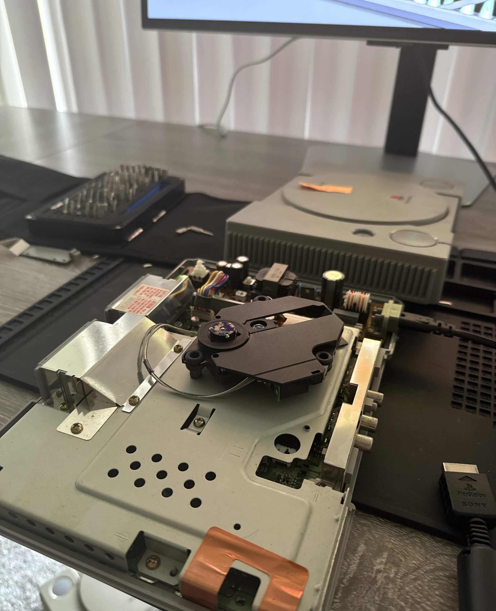
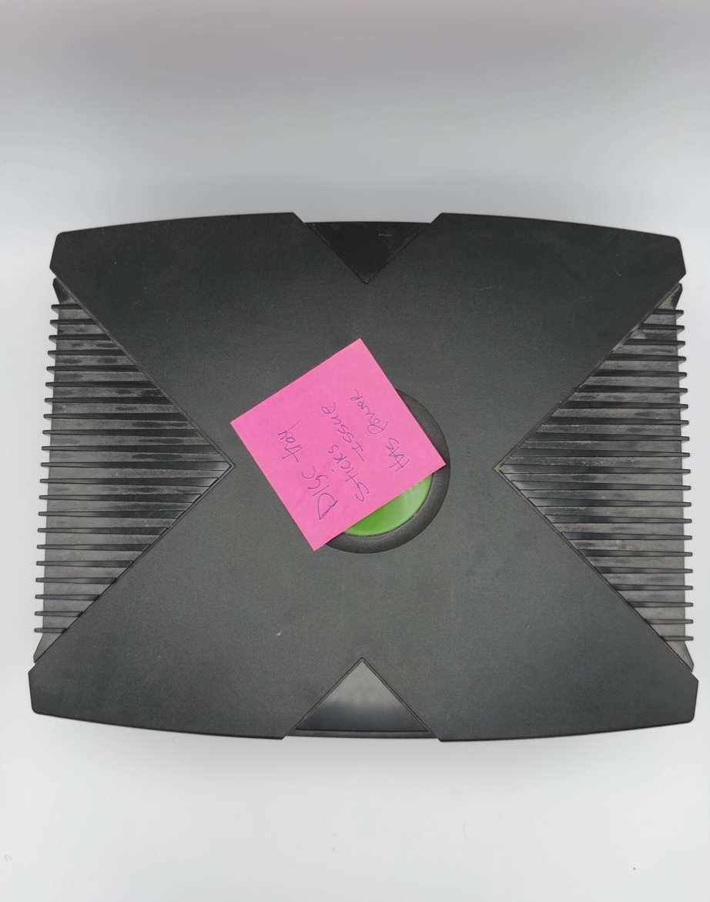
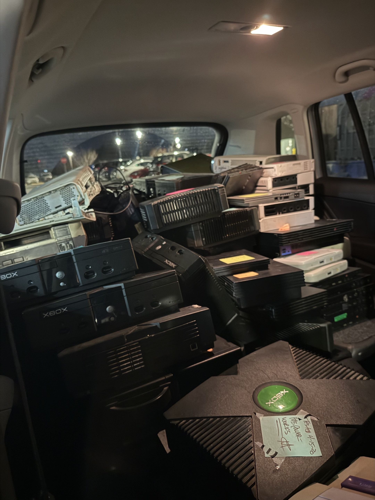
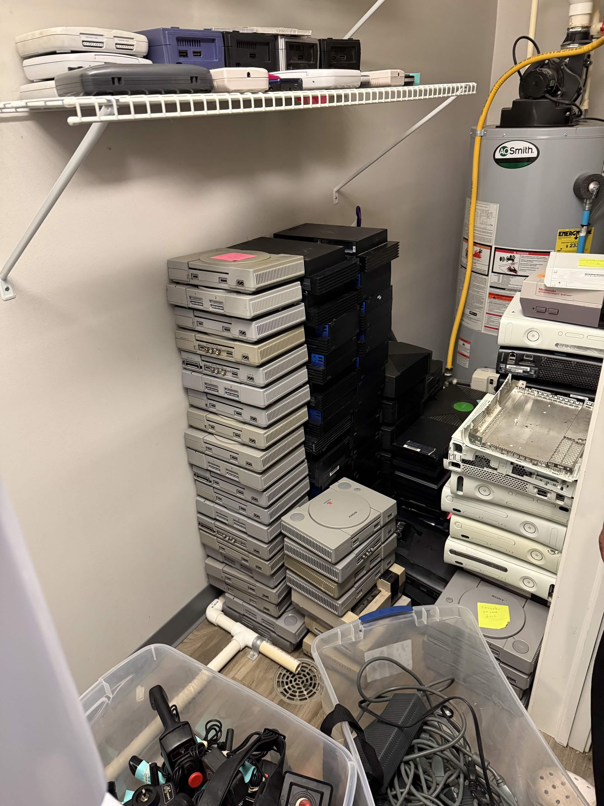
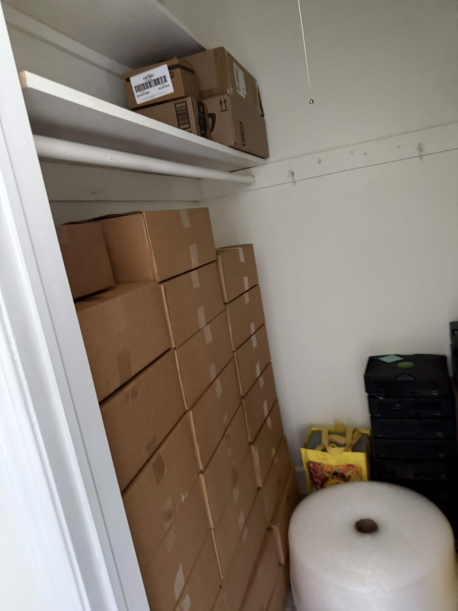

# Behind Bytronyx

[Repair log](../repairs/README.md) · [Product photos](photo-gallery.md)

## At the bench

| PlayStation | Xbox fault note |
| --- | --- |
|  |  |
| Opened PlayStation with the optical drive exposed. | Xbox tagged for a sticking disc tray. |

## Stock and packing

I buy broken consoles to repair and resell. These photos show a stock purchase,
stored consoles, and packing supplies.

| Buying stock | Console storage | Packing supplies |
| --- | --- | --- |
|  |  |  |
